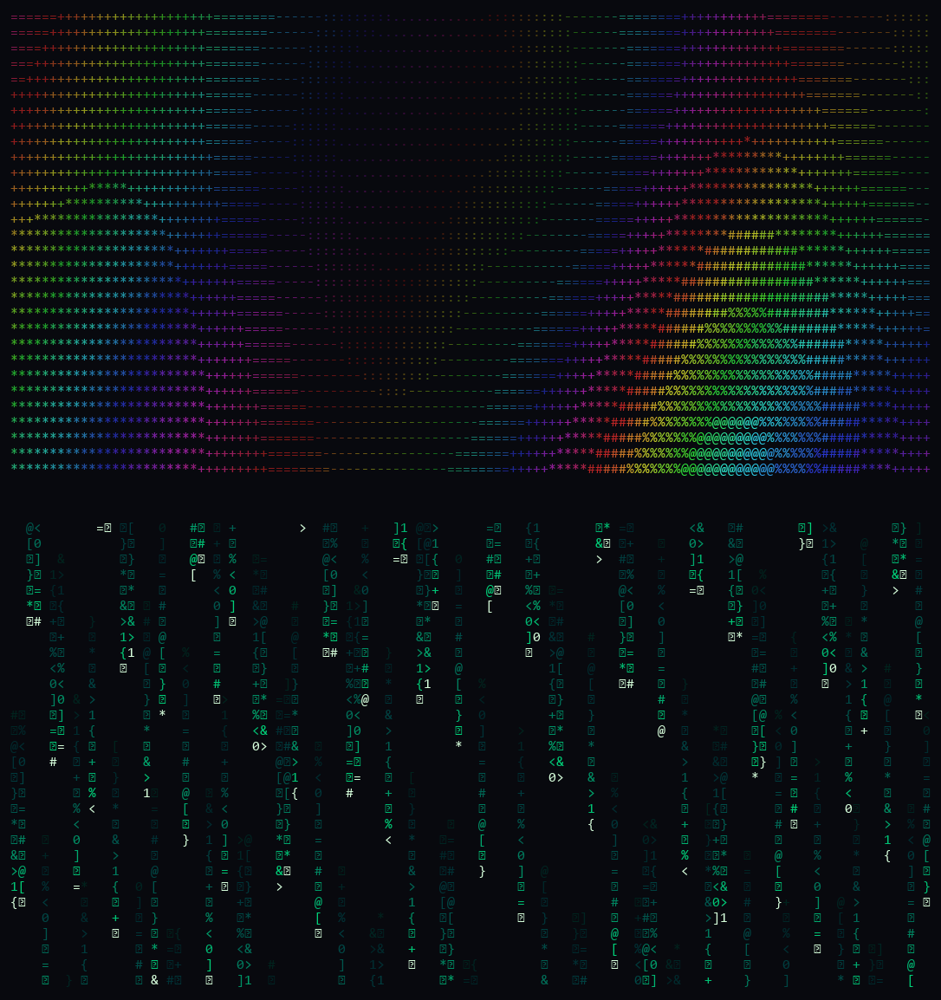

# ASCII Art Terminal

[](https://github.com/kenzzyxd-bit/ascii-art-terminal/actions/workflows/tests.yml)


Convert gambar, GIF, atau video jadi **ASCII art berwarna** yang jalan animasi langsung di terminal.

Ditulis dengan Python + Pillow, output pakai **ANSI truecolor 24-bit**.



## Fitur

- **Dua mode demo** — plasma halus atau hujan karakter matrix, tanpa file apa pun
- **Gambar / GIF / PNG / JPG** — dibaca lewat Pillow
- **Video (MP4/MKV/WebM/MOV)** — frame diambil lewat `ffmpeg`
- **Truecolor ANSI** `\x1b[38;2;R;G;Bm`, bukan 256 warna
- **Rasio karakter dikoreksi** (sel terminal ~2× tinggi) biar gambar gak ketarik
- `--boost` buat gambar gelap, `--width` & `--fps` buat atur ukuran dan kecepatan

## Instalasi

```bash
pip install pillow          # wajib
ffmpeg                      # opsional, cuma buat video
```

## Pemakaian

```bash
python ascii.py                          # demo plasma
python ascii.py --demo matrix            # demo hujan karakter
python ascii.py foto.jpg                 # render sekali
python ascii.py anim.gif                 # animasi loop
python ascii.py video.mp4                # video, lewat ffmpeg
python ascii.py foto.jpg --boost 2       # gambar gelap biar lebih kebaca
python ascii.py anim.gif --width 120 --fps 20
python ascii.py --once --demo matrix     # cetak 1 frame (buat tes/screenshot)
```

Stop: `Ctrl+C`.

Windows: jalankan di **Windows Terminal** (truecolor gak jalan di `cmd.exe` lama), atau double-click `run.bat`.

## Cara kerja

1. Frame diperkecil jadi grid ± lebar terminal × 0.5 (koreksi aspek karakter)
2. Terang tiap piksel (0.299R + 0.587G + 0.114B) dipetakan ke ramp `" .:-=+*#%@"`
3. Tiap karakter diwarnai sesuai piksel aslinya, satu string per baris
4. Frame ditulis setelah `\x1b[H` (kursor balik ke atas) → jadi animasi

Performa di laptop uji: plasma ~5.6 ms/frame, matrix ~3.4 ms (118×28 kolom, >170 fps di Python murni).

## Struktur

```
ascii.py     script utama
test.py      cek cepat (assert): py -3 test.py -> ok
run.bat      launcher Windows (auto-install Pillow)
```

## Lisensi

MIT — lihat [LICENSE](LICENSE).
